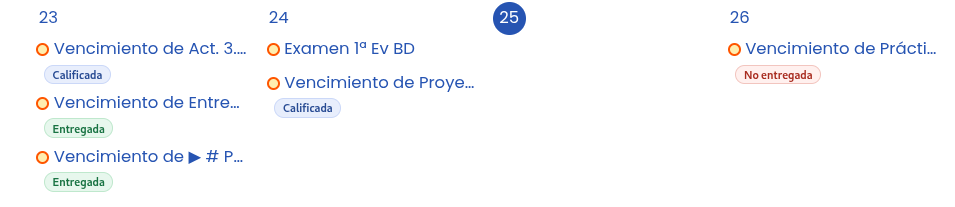
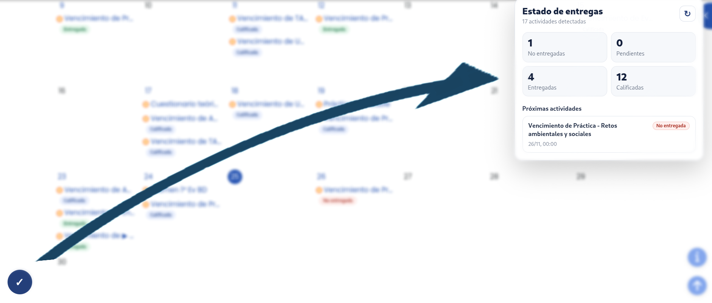

# Moodle Calendar Status

See which assignments you still need to submit in the Junta de Andalucía Moodle calendar. The extension adds Spanish status labels to assignments and quizzes. Click **✓** in the bottom left to see a summary and upcoming deadlines. Inside the panel, click **↻** to check again.

## Install

1. Download and unzip the repository, or clone it.
2. Open the extensions page in Chrome, Edge or Brave. Enable **Developer mode** and disable any older copy of the extension.
3. Click **Load unpacked** and select the folder containing `manifest.json`.
4. Sign in to Moodle and reload your calendar.

## How it works

The extension checks assignments by course. When a course overview lacks enough detail, it reads the activity page using your existing Moodle session. It reuses confirmed statuses for up to two minutes in the same tab. Requests stay on your Moodle campus, and the cache stores neither passwords nor grades.

